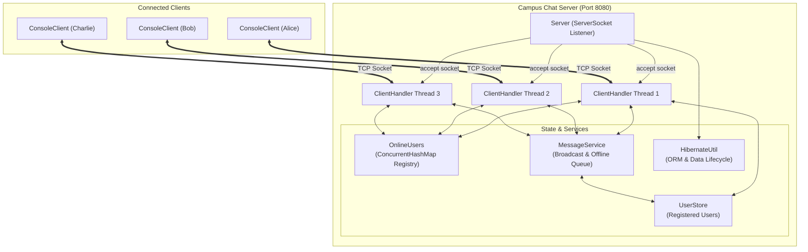

# Campus Chat — Architecture & Developer Guide

Campus Chat is a multi-threaded, socket-based Java chat application implementing a custom pipe-delimited text protocol (`COMMAND|argument`). It features concurrent client connections, user authentication, live message broadcasting, offline message persistence, and fault-tolerant socket handling.

---

## 1. System Architecture

The application follows a multithreaded client-server architecture over TCP/IP sockets.



### Key Architectural Characteristics
1. **Thread-Per-Client Model**: The server's main listener loop blocks on `ServerSocket.accept()`. When a client connects, a new `ClientHandler` instance is wrapped in a dedicated `Thread` so network I/O operations for one client never block another.
2. **Decoupled Concurrency & Registry**: Active connections are tracked globally by `OnlineUsers` using thread-safe concurrency primitives (`ConcurrentHashMap`).
3. **Decoupled Messaging & Offline Sync**: Messages are broadcast via `MessageService`. If a registered recipient is offline, the message is queued in an offline store and flushed when the user subsequently logs in (`SYNC_START` -> `MSG|...` -> `SYNC_END`).
4. **Fault Tolerance**: Network failures, abrupt socket closes, and simulated database errors are intercepted in per-thread `try-catch-finally` blocks, preventing individual client failures from terminating the server.

---

## 2. Communication Protocol Specification

All socket messages are line-delimited text (`UTF-8`), separated by the pipe character `|`.

| Flow | Command / Message | Description |
| :--- | :--- | :--- |
| **Client → Server** | `LOGIN\|<username>` | Authenticates as `<username>`. |
| **Client → Server** | `CHAT\|<text>` | Sends `<text>` to be broadcast to all users. |
| **Client → Server** | `LOGOUT` | Disconnects and terminates the active session. |
| **Server → Client** | `OK\|Welcome <username>` | Confirms successful login. |
| **Server → Client** | `OK\|Logged out` | Confirms successful logout. |
| **Server → Client** | `MSG\|<sender>\|<text>` | Live or queued chat message. |
| **Server → Client** | `SYNC_START` | Signals beginning of missed/offline message delivery. |
| **Server → Client** | `SYNC_END` | Signals end of missed/offline message delivery. |
| **Server → Client** | `ERROR\|<reason>` | Returns error message (`No such user`, `Already logged in`, `Not logged in`, `Unknown command`, `Server problem, please try again`). |

---

## 3. Directory Structure & File-by-File Breakdown

```
campus-chat-v1/
├── pom.xml                                            <-- Root parent POM
├── README.md                                          <-- System documentation (this file)
├── .gitignore                                         <-- Git ignore rules
├── .vscode/
│   └── settings.json                                  <-- Workspace editor preferences
└── demo/
    ├── pom.xml                                        <-- Demo module build configuration
    ├── data/                                          <-- Local H2 database file storage directory
    └── src/
        ├── main/java/com/campuschat/
        │   ├── client/
        │   │   └── ConsoleClient.java                 <-- Terminal chat client entry point
        │   └── server/
        │       ├── Server.java                        <-- Socket server listener entry point
        │       ├── ClientHandler.java                 <-- Dedicated worker thread per client
        │       ├── OnlineUsers.java                   <-- Active client session registry
        │       ├── MessageService.java                <-- Chat broadcast & offline queueing
        │       ├── UserStore.java                     <-- User validation & account store
        │       └── HibernateUtil.java                 <-- Database lifecycle management
        └── test/java/com/campuschat/server/
            ├── CampusChatServerTest.java              <-- Server integration test suite
            └── UserStoreTest.java                     <-- UserStore unit test suite
```

### Detailed Component Explanations

#### 1. Root & Build Configuration
* **`pom.xml` (Root)**:
  * Defines the parent multi-module Maven configuration (`<packaging>pom</packaging>`).
  * Aggregates the `demo` child module.
* **`demo/pom.xml`**:
  * Configures Java 17 compatibility (`<maven.compiler.source>17</maven.compiler.source>`).
  * Declares test dependencies: JUnit Jupiter 5.10.2 (`junit-jupiter`).
  * Configures `maven-surefire-plugin` (version 3.2.5) for test execution.
* **`.gitignore`**:
  * Excludes Maven build artifacts (`target/`), IDE configuration (`.idea/`, `*.iml`), database storage files (`demo/data/`), and temporary logs.
* **`.vscode/settings.json`**:
  * Editor configuration for workspace navigation and code formatting.

---

#### 2. Server Core Components (`com.campuschat.server`)

* **`Server.java`**:
  * **Role**: Main server entry point.
  * **How it works**:
    1. Initializes `HibernateUtil.init("hibernate.cfg.xml")` to ensure database readiness before accepting client connections.
    2. Registers a JVM shutdown hook (`Runtime.getRuntime().addShutdownHook(...)`) that calls `HibernateUtil.shutdown()` for clean termination.
    3. Opens a `ServerSocket` on port `8080` (or a port passed as command-line argument `args[0]`).
    4. Loops continuously on `serverSocket.accept()`, instantiating a `ClientHandler` and launching it in a new thread for each connection.
    5. Implements `stop()` to cleanly close the `ServerSocket`.

* **`ClientHandler.java`**:
  * **Role**: Manages the life cycle and communication of a single connected client.
  * **How it works**:
    1. Implements `Runnable`. Runs in its own thread to ensure non-blocking I/O.
    2. Wraps the socket input/output streams with `BufferedReader` and `PrintWriter` using `StandardCharsets.UTF_8`.
    3. Reads commands line-by-line and splits them into `COMMAND|argument`.
    4. Dispatches commands to handler methods:
       * `LOGIN`: Validates user exists in `UserStore`, verifies user is not already logged in via `OnlineUsers`, registers the handler, responds with `OK|Welcome <username>`, and triggers `MessageService.deliverMissed()`.
       * `CHAT`: Ensures client is authenticated, then delegates to `MessageService.sendChat()`.
       * `LOGOUT`: Unregisters user from `OnlineUsers`, sends `OK|Logged out`, and breaks loop.
    5. **Concurrency & Safety**:
       * The `send(String line)` method is `synchronized` to prevent packet/line interleaving when multiple threads broadcast messages concurrently.
       * The `cleanup()` method in the `finally` block ensures sockets are closed and crashed clients are immediately purged from `OnlineUsers`.

* **`OnlineUsers.java`**:
  * **Role**: Thread-safe directory of currently active users.
  * **How it works**:
    1. Backed by a `ConcurrentHashMap<String, ClientHandler>`.
    2. Provides atomic and synchronized registry actions: `add(username, handler)`, `remove(username)`, `get(username)`, `isOnline(username)`, `getAll()`, and `clear()`.
    3. Includes case-insensitive lookups so usernames like `Alice` and `alice` resolve consistently.

---

#### 3. Storage & Service Layer (`com.campuschat.server`)

* **`MessageService.java`**:
  * **Role**: Manages message broadcasting and offline message delivery.
  * **How it works**:
    1. **Live Broadcast**: When `sendChat(sender, text)` is called, it constructs `MSG|<sender>|<text>` and sends it to all handlers in `OnlineUsers.getAll()`.
    2. **Offline Queuing**: In the same `sendChat` call, it checks all registered users in `UserStore.allUsernames()`. Any user who is currently offline (and not the sender) has the message stored in a thread-safe `ConcurrentHashMap<String, List<String>> offlineQueue`.
    3. **Missed Message Delivery**: When a user logs in, `deliverMissed(username, handler)` is invoked:
       * Sends `SYNC_START`.
       * Flushes and removes queued messages for that user.
       * Sends `SYNC_END`.
    4. **Fault Simulation**: Provides `setSimulateDatabaseError(boolean)` to test resilience against service and database outages.

* **`UserStore.java`**:
  * **Role**: User account repository and authentication authority.
  * **How it works**:
    1. Manages a synchronized `Set<String>` of registered user accounts.
    2. Pre-seeded with default users: `alice`, `bob`, `charlie`, and `aryan`.
    3. Normalizes all user lookups using `clean()` (trimming whitespace and lowercasing).
    4. Provides `addUser(name)`, `removeUser(name)`, `exists(name)`, and `allUsernames()`.
    5. Includes database health simulation hooks (`setSimulateDatabaseError`).
    *Note: Designed to be swapped with a Hibernate-backed entity repository in future milestones.*

* **`HibernateUtil.java`**:
  * **Role**: Lifecycle manager for database persistence and ORM.
  * **How it works**:
    1. Provides `init(configFile)` which verifies/creates the local `data/` directory for database storage.
    2. Provides `shutdown()` to close connection pools cleanly when the server exits.
    3. Serves as the integration stub for upcoming Hibernate ORM & H2 database configuration.

---

#### 4. Client Component (`com.campuschat.client`)

* **`ConsoleClient.java`**:
  * **Role**: Command-line interface for end users.
  * **How it works**:
    1. Connects to `localhost:8080` via a TCP `Socket`.
    2. **Asynchronous Reader Thread**: Spawns a background daemon thread that reads lines from the server socket continuously, formats protocol messages (`MSG|...`, `SYNC_START`, etc.) into readable chat lines, and displays them on the console.
    3. **Foreground Input Loop**: Reads user input from `System.in`:
       * Prompts for username at startup and transmits `LOGIN|<username>`.
       * `/login <username>`: Sends a login command.
       * `/quit`: Sends `LOGOUT` and closes the client.
       * Standard text: Automatically wraps input into `CHAT|<text>` and sends it to the server.

---

#### 5. Automated Test Suite (`com.campuschat.server`)

* **`CampusChatServerTest.java`**:
  * Comprehensive integration test suite using JUnit 5.
  * Uses an internal `TestClient` socket helper connecting on dynamic test port `18080`.
  * **Scenarios verified**:
    1. `testOnlineUsersRegistry`: Validates addition, lookup, and removal from `OnlineUsers`.
    2. `testUnknownCommandGivesError`: Ensures non-protocol commands receive `ERROR|Unknown command`.
    3. `testLoginNonExistentUserFails`: Verifies unlisted accounts receive `ERROR|No such user`.
    4. `testLoginSuccessAndMissedDelivery`: Verifies `SYNC_START` / `SYNC_END` offline delivery.
    5. `testDuplicateLoginRejected`: Rejects simultaneous logins with the same username.
    6. `testChatWhenNotLoggedInIsRejected`: Rejects chat attempts before authentication.
    7. `testTwoClientsCanConnectAndChatConcurrently`: Confirms concurrent bidirectional message delivery.
    8. `testOfflineUserReceivesMissedMessagesUponLogin`: Validates end-to-end offline message persistence and delivery.
    9. `testClosingClientWindowRemovesItFromOnlineUsers`: Tests client disconnection cleanup.
    10. `testServerKeepsRunningAfterClientCrash`: Proves abrupt client disconnects don't terminate the server.
    11. `testDatabaseErrorGivesErrorReplyAndDoesNotCrashServer`: Verifies graceful failure on simulated DB fault.
    12. `testHibernateStartupCreatesDataFolderAndCleanShutdown`: Verifies storage directory creation and clean shutdown.

* **`UserStoreTest.java`**:
  * Unit tests for account storage and validation logic.
  * Tests case insensitivity, whitespace trimming, duplicate prevention, and simulated error propagation.

---

## 4. How to Run and Navigate the Project

### Prerequisites
* **Java Development Kit (JDK) 17** or higher installed and on system `PATH`.
* Optional: Apache Maven 3.8+ (for command-line builds).

---

### Method A: Running via IDE (Antigravity IDE / VS Code)

1. **Start the Server**:
   * Open [`Server.java`](demo/src/main/java/com/campuschat/server/Server.java).
   * Click the **Run** button directly above `public static void main(String[] args)`.
   * The server starts listening on port 8080.
2. **Start Client 1 (Bob)**:
   * Open [`ConsoleClient.java`](demo/src/main/java/com/campuschat/client/ConsoleClient.java) and click **Run**.
   * Enter username: `bob`.
   * Type messages and hit **Enter**.
3. **Start Client 2 (Alice)**:
   * Open a new terminal or run a second instance of [`ConsoleClient.java`](demo/src/main/java/com/campuschat/client/ConsoleClient.java).
   * Enter username: `alice`.
   * Chat messages appear in real time across both consoles.

---

### Method B: Running via PowerShell / Terminal

1. **Compile all Java classes**:
   ```powershell
   javac -d demo/target/classes (Get-ChildItem -Path demo\src\main\java -Filter *.java -Recurse | Select-Object -ExpandProperty FullName)
   ```

2. **Launch the Server**:
   ```powershell
   java -cp demo/target/classes com.campuschat.server.Server
   ```
   *Expected output:*
   ```text
   [Hibernate] Initializing Hibernate ORM with config: hibernate.cfg.xml
   [Hibernate] SessionFactory built successfully.
   [Hibernate] Connected to H2 database in data/ directory.
   Campus Chat Server started and listening on port 8080...
   ```

3. **Launch the Client (in a separate terminal)**:
   ```powershell
   java -cp demo/target/classes com.campuschat.client.ConsoleClient
   ```

---

### Testing Offline Messages Flow

1. Start the server.
2. Open a client, log in as `bob`, and type:
   ```text
   Hello Alice, let me know when you read this!
   ```
3. Type `/quit` to close Bob's client.
4. Open a client and log in as `alice`.
5. Alice receives:
   ```text
   Welcome alice
   --- missed messages ---
   bob: Hello Alice, let me know when you read this!
   --- end ---
   ```

---

### Running the Test Suite

* **Inside IDE**: Open `CampusChatServerTest.java` or `UserStoreTest.java` and click **Run Test** next to any test method or the class name.
* **Via Maven**:
  ```powershell
  mvn test
  ```

